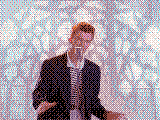
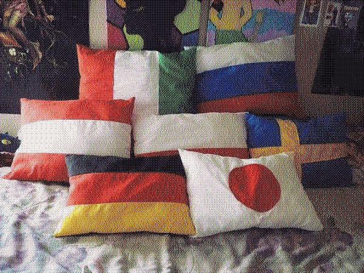
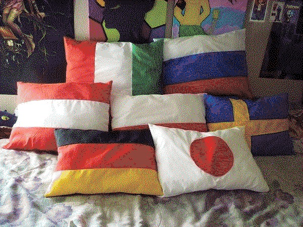

# pic2mkcapix
## Convert Picture to Makecode-arcade or Pixel-art

 

---

visit at [page](https://quarequin.github.io/pic2mkcapix)

download offline at [here](https://github.com/Quarequin/pic2mkcapix/releases/latest/download/PIC2MKCA.htm)

download source at [here](https://github.com/Quarequin/pic2mkcapix/raw/refs/heads/main/pack/PIC2MKCA.zip)

<dl>
    <dt>note for anti-ai user:</dt>
    <dd>this project use <i>ai</i> to make project but you can fork this to make clean-code-reverse-engineer as human code(if possible) sorry. :(</dd>
</dl>

---

## Navigation

- [Update](UPDATE.md)
- [Humanize](HUMANIZE.md)
- [Robotice](ROBOTICE.md)